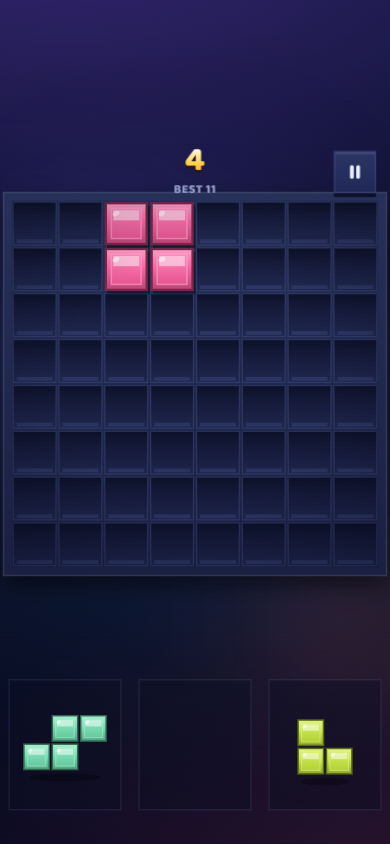
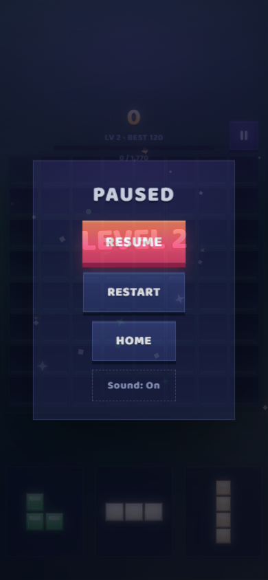
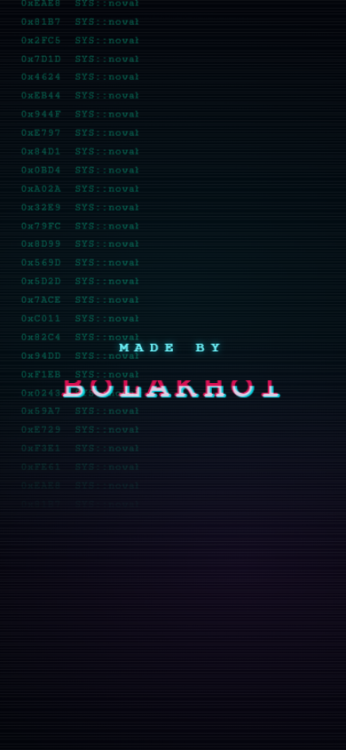
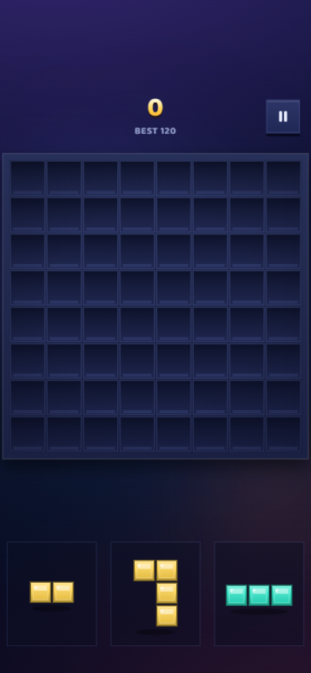

# 🎮 NOVA BLOCKS

> Đặt khối — lấp hàng — phá đảo. Một game puzzle 8×8 đúng chất Block Blast, tự làm từ đầu đến cuối.

**🌐 Chơi ngay trên web:** https://novablock.web.app

**📱 Tải APK (Android 7.0+):** tải file `NovaBlocks-v1.0.0.apk` trong repo này → mở file trên điện thoại → cho phép "Cài đặt từ nguồn không xác định" → cài → chơi. (Cài đè lên bản cũ được, lưu game giữ nguyên.)

## ✨ Có gì trong game

- **2 chế độ:** Adventure (qua màn theo target, phá sạch board để nổ tung sang khung cảnh mới) và Endless (chơi tới khi thua, phá đảo +300)
- **9 khung cảnh theo màn** — mỗi màn một bảng màu khối riêng: màn cây dừa cho khối lá dừa, cơm dừa, cát; màn dưa hấu cho khối đỏ ruột, vỏ xanh…
- **Dealer AI kiểu Block Blast:** combo cao, chơi ngon — game "đọc vị" và thỉnh thoảng rót bộ khối xấu khiến bạn phải chơi lại màn từ đầu 😈
- **Pity system:** kẹt quá lâu sẽ được tự động chuyển khung cảnh mới — không ai phải ngồi tù một màn
- **Điểm số, combo x8, all-clear, hiệu ứng nổ** đầy đủ màu mè
- **Tự co giãn theo mọi màn hình** — điện thoại dọc/ngang, tablet, PC (có phím tắt 1/2/3 + mũi tên + Enter)
- **Intro Cyberpunk/Glitch** đúng chất hacker mỗi lần mở game
- **Không quảng cáo, không thu thập dữ liệu cá nhân** — chơi offline thoải mái

## 📸 Một chút màu mè

| Intro Glitch | Bố cục tự cân |
|---|---|
|  |  |

## 📦 Phiên bản

| Version | Ngày | Ghi chú |
|---|---|---|
| **v1.0.0** | 25/10/2026 | Bản công khai đầu tiên: 2 chế độ, 9 theme, dealer AI, pity, glitch intro, APK + web |

## 🔒 Về source code

Repo này **chỉ chứa bản release** (giới thiệu + APK + ảnh) — mã nguồn không công khai.

---

**MADE BY BOLAKHOI** 🚀
